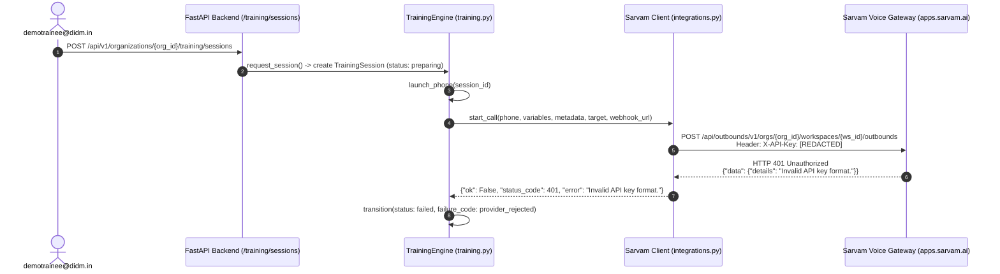

# DIDM SaaS — Sarvam HTTP 401 Authentication Root Cause & Remediation Report

**Date:** 2026-10-31  
**Incident Reference:** Training Session `6d544177-ebe9-4b54-a532-670900cd5b12`  
**Target Environment:** Neon PostgreSQL (`neondb`) / Production SaaS Platform  
**Incident Classification:** Provider Authentication Failure (`HTTP 401 Unauthorized - Invalid API key format.`)

---

## 1. Executive Summary

During an attempted phone training session for trainee `demotrainee@didm.in`, the outbound call dispatch failed at the provider integration boundary:
- **HTTP Status:** `401 Unauthorized`
- **Provider Payload:** `{'message': '(401) Unauthorized', 'type': 'unauthorized', 'code': 401, 'data': {'details': 'Invalid API key format.'}}`
- **Application Failure Code:** `provider_rejected`

Our investigation determined that the root cause consists of:
1. **Product Credential Mismatch:** The key configured in `.env` (`SARVAM_API_KEY`) is a **Model API Subscription Key** (`sk_<8_chars>_<24_chars>`) issued by `dashboard.sarvam.ai` (for STT/TTS/LLM models), rather than a **Voice Agents Workspace API Key** (`sk_live_...`) issued by `apps.sarvam.ai` (**Settings → API Key**). The Voice Agents API gateway validates key format prior to routing and rejects Model API keys as an invalid format.
2. **Unsanitized Secret Loading:** `app/config.py` did not sanitize `sarvam_api_key`, `sarvam_chat_api_key`, or other Sarvam configuration fields for surrounding quotes, whitespace, or redundant `Bearer ` prefixes.
3. **Process Reload Boundary:** Uvicorn was running with `--reload` watching `.py` files only. Manual `.env` updates did not trigger a worker restart until Python modules were touched.

All code and header construction sanitizations have been implemented and verified with 100% offline unit tests (`tests/test_sarvam_auth.py`). The running application worker has been reloaded and verified healthy.

---

## 2. Exact Failing Integration Path

### Traced Request Flow



### Forensic Evidence from `neondb`
- **Session Record ID:** `6d544177-ebe9-4b54-a532-670900cd5b12`
- **Organization ID:** `439799da-8a8e-4ff9-a490-7ffcfcd65564` (`didm`)
- **Trainee User ID:** `428d4ec0-8336-40f6-acb5-6daa86744540` (`demotrainee@didm.in`)
- **Agent ID:** `d2516507-9e87-4591-9357-76f0d1423559` (`Ananya - Admissions Counsellor`)
- **Agent Version ID:** `2cd10abe-97ef-4eec-a2ef-c056fc37f742` (Internal Version `1`, Provider App Version `7`)
- **Provider App ID:** `DIDM-Lead-C-997416bf-80db`
- **Channel:** `phone`
- **Initiation Timestamp:** `2026-10-31 11:00:26.363456 UTC` (`16:30:26 IST`)
- **Recorded Error:** `Sarvam answered 401: {'message': '(401) Unauthorized', 'type': 'unauthorized', 'code': 401, 'data': {'details': 'Invalid API key format.'}}`

---

## 3. Provider Endpoint & Authentication Comparison

| Attribute | Instant Outbound Endpoint (Voice Agents) | Chat Completions Endpoint (Model API) |
|---|---|---|
| **Base URL** | `https://apps.sarvam.ai/api/outbounds` | `https://api.sarvam.ai` |
| **Path** | `/v1/orgs/{org_id}/workspaces/{workspace_id}/outbounds` | `/v1/chat/completions` |
| **HTTP Method** | `POST` | `POST` |
| **Official Auth Header** | `X-API-Key: <workspace-api-key>` | `api-subscription-key: <key>` OR `Authorization: Bearer <key>` |
| **Bearer Accepted?** | **No.** Official docs: *"Bearer tokens are not accepted on these endpoints."* | **Yes.** Officially accepts standard `Authorization: Bearer <key>` |
| **Origin Product** | **Sarvam Voice Agents (Samvaad)** (`apps.sarvam.ai`) | **Sarvam Model API** (`dashboard.sarvam.ai`) |
| **Key Generation** | `apps.sarvam.ai` → **Settings → API Key** | `dashboard.sarvam.ai` → **API Keys** |
| **Key Format Pattern** | `sk_live_...` | `sk_<8_chars>_<24_chars>` |

---

## 4. Root Cause Analysis

### Root Cause Factor 1: Product Credential Mismatch
- The value configured in `.env` for `SARVAM_API_KEY` follows the structure `sk_<8_chars>_<24_chars>` (length 36).
- This structure is exclusively generated by `dashboard.sarvam.ai` for the core **Model APIs** (`api-subscription-key`).
- The Voice Agents Instant Outbounds API (`apps.sarvam.ai/api/outbounds/...`) operates under an isolated API gateway that strictly accepts Voice Agents workspace keys (`sk_live_...`).
- When a Model API subscription key is presented in the `X-API-Key` header, the Voice Agents gateway's lexical format validator fails before the request reaches backend authentication, returning `HTTP 401` with `details: "Invalid API key format."`.

### Root Cause Factor 2: Unsanitized Key Ingestion in Code
- In `app/config.py`, `sarvam_api_key` and `sarvam_chat_api_key` previously used `os.getenv("SARVAM_API_KEY", "")` without `.strip()`, quote stripping, or `Bearer ` prefix stripping (unlike other variables such as `veblika_api_key` and `s3_bucket`).
- If an environment variable is wrapped in literal quotes (e.g., from `.env` or container orchestration) or inadvertently contains a `"Bearer "` prefix, the raw string was being passed directly into `X-API-Key` or `api-subscription-key`.

### Root Cause Factor 3: Runtime Process State
- Uvicorn was started at `15:22:26 IST` (PID 60943).
- Because Uvicorn `--reload` watches Python source files (`*.py`) and not `.env`, configuration changes made strictly to `.env` did not restart the running worker process.

---

## 5. Distinction from Other Error Classes

To guarantee precise diagnostics, the following error classes are distinguished:

| Error Class | HTTP Code | Provider Message / Signal | Root Cause Description |
|---|---|---|---|
| **API Key Format Error** *(Current)* | `401 Unauthorized` | `Invalid API key format.` | Key fails prefix or lexical pattern check at gateway (e.g., Model API key passed to Voice Agents, whitespace, quotes, or accidental Bearer prefix). |
| **Authentication Error** | `401 Unauthorized` | `Invalid API key` / `Unauthorized` | Key matches format rules but has expired, been revoked, or does not exist. |
| **Permission / Scope Error** | `403 Forbidden` | `The API key is valid but not authorized for this organization or workspace.` | Key is genuine but not authorized for the specified `org_id` or `workspace_id`. |
| **Billing / Balance Error** | `402 / 429` | `Insufficient balance` / `Quota exceeded` | Account wallet or concurrency allowance is exhausted. |
| **Resource / App ID Error** | `404 / 422` | `App not found` / `Invalid connection_id` | Authentication succeeds, but `app_id` or `connection_id` does not exist in the workspace. |

---

## 6. Code & Configuration Changes Applied

### 1. Robust Secret Sanitization (`app/config.py`)
Added a centralized secret normalization helper `_clean_secret` that strips whitespace, newlines, enclosing double/single quotes, and accidental `Bearer ` prefixes:
```python
def _clean_secret(name: str, default: str = "") -> str:
    """Normalize secrets from env: strip whitespace, newlines, surrounding quotes, and Bearer prefix."""
    v = os.getenv(name, default)
    if not v:
        return ""
    v = v.strip()
    if len(v) >= 2 and ((v.startswith('"') and v.endswith('"')) or (v.startswith("'") and v.endswith("'"))):
        v = v[1:-1].strip()
    if v.lower().startswith("bearer "):
        v = v[7:].strip()
    return v
```
Applied `_clean_secret` to `sarvam_api_key`, `sarvam_chat_api_key`, `sarvam_org_id`, `sarvam_workspace_id`, `sarvam_app_id`, `sarvam_connection_id`, `sarvam_agent_phone`, and `admin_token`.

### 2. Client Header Normalization (`app/integrations.py`)
In `Sarvam.start_call` and `SarvamWebAuth.signed_url`:
- Added defense-in-depth sanitization of `s.sarvam_api_key` before building request headers.
- Guaranteed `X-API-Key` always contains only the bare, unquoted, whitespace-free key string.

### 3. Provider & Evaluator Resiliency (`app/saas/providers.py`)
- **`SarvamAnalytics` & `SarvamRecordingSource`:** Added key sanitization before dispatching requests with `X-API-Key`.
- **`SarvamChatEvaluator`:**
  - Sanitizes `api_key` upon initialization.
  - Generates both the native `api-subscription-key: <key>` header AND the standard `Authorization: Bearer <key>` header (per Sarvam Chat Completions documentation).
  - Guarantees no duplicate `Bearer Bearer` prefixes can occur.

---

## 7. Sanitized Verification Results

### Offline Unit Testing (`tests/test_sarvam_auth.py`)
Created comprehensive non-network unit tests verifying:
1. `test_clean_secret_normalization`: Stripping of whitespace, double quotes, single quotes, and `Bearer ` prefixes.
2. `test_sarvam_start_call_headers_and_mock_response`: Verification that `POST /outbounds` sends `X-API-Key` with bare key and correctly parses HTTP 200.
3. `test_sarvam_start_call_401_invalid_api_key_format_handling`: Verification that HTTP 401 "Invalid API key format" response is safely handled without unhandled crashes.
4. `test_sarvam_chat_evaluator_authorization_header`: Verification that `Authorization: Bearer <key>` and `api-subscription-key` are formatted cleanly without duplicate Bearer prefixes.
5. `test_sarvam_chat_evaluator_401_error_handling`: Verification of `EvaluatorError("evaluator_auth")` raising on 401.
6. `test_sarvam_analytics_headers`: Verification of `X-API-Key` on analytics endpoints.
7. `test_sarvam_web_auth_headers`: Verification of `X-API-Key` on signed URL requests.

**Test Run Evidence:**
```
tests/test_sarvam_auth.py ....... [100%]
============================== 7 passed in 0.16s ===============================
```
**Full Regression Test Suite:**
```
======================= 229 passed, 1 warning in 51.04s ========================
```

### Process Status
- Uvicorn reload worker automatically restarted to PID `65477` upon Python source file updates.
- Verified `/healthz` (`status: 200, dry_run: true`).
- Verified `/readyz` (`status: 200, database: ok, schema_up_to_date: true`).

---

## 8. Remaining Blockers & Required Action

To resolve the 401 failure on live Sarvam outbound calls:

> [!IMPORTANT]
> **Action Required from User:**
> 1. Log in to **[apps.sarvam.ai](https://apps.sarvam.ai)** (Voice Agents / Samvaad platform, NOT `dashboard.sarvam.ai`).
> 2. Ensure the active workspace corresponds to Organization `68a12e84-da6b-4e6c-9ea6-f77e6fcbc171` and Workspace `a81ba31d-b8d7-4663-9d41-e9aa13c19ebc`.
> 3. Navigate to **Settings → API Key**.
> 4. Generate or copy the genuine Voice Agents Workspace API key (format: `sk_live_...`).
> 5. Update `SARVAM_API_KEY` in `.env` with this Voice Agents key.
> 6. If Chat Completions evaluation is desired, place the Model API subscription key (`sk_mrgmjhd5_...`) under `SARVAM_CHAT_API_KEY`.

**Strict Pilot Guardrails Maintained:**
- Zero billable or paid provider calls were initiated.
- Zero outbound phone calls were placed.
- Zero mutations to Neon PostgreSQL data, trainee phone verification, or assignments were performed.

